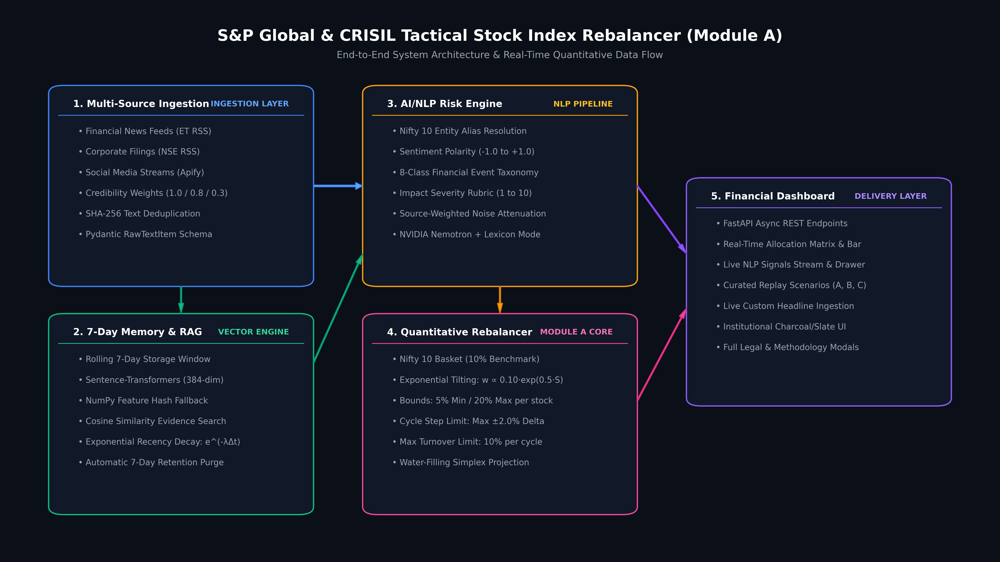

# Real-Time AI Financial Risk Engine & Tactical Stock Index Rebalancer - S&P Global & Crisil Campus Hackathon

**Candidate Name:** Trisha  
**College Email ID:** trisha@igdtuw.ac.in  
**College / Campus:** Indira Gandhi Delhi Technical University for Women (IGDTUW)  
**Demo Video Link:** [YouTube / Unlisted - Video Link](https://youtu.be/placeholder-demo-link)  
**Slide Deck Link (if hosted externally):** [View Presentation Deck (PDF)](docs/presentation.pdf)  

---

## 1. Project Overview / Problem Statement & Approach

In modern financial markets, critical corporate events—such as unexpected regulatory penalties, leadership resignations, mega contract wins, and credit warnings—break out on unstructured channels (breaking news feeds, exchange filings, and social media) hours or days before they reflect in quarterly financial filings. Asset managers and quantitative index providers struggle with the manual bottleneck of processing thousands of noisy textual items per minute, resulting in delayed portfolio reactions, capital drawdowns, and missed alpha opportunities.

To solve this challenge, we built a unified **Real-Time AI/NLP Financial Risk Engine and Tactical Stock Index Rebalancer (Module A)**. The system continuously ingests multi-source unstructured streams, resolves mentions to constituent companies within a representative **Nifty 10 Indian Blue-Chip Basket**, scores sentiment on a $[-1.0, +1.0]$ continuous scale, classifies events across an 8-class financial taxonomy, and evaluates market impact severity on an institutional $1\text{--}10$ rubric.

Rather than treating incoming news in isolation, our architecture maintains a rolling **7-Day Memory Store with Vector Retrieval (RAG)**, combining semantic similarity with an exponential temporal decay function ($e^{-\lambda \cdot \Delta t}$). The downstream quantitative rebalancer then dynamically tilts constituent portfolio weights away from penalized firms and towards outperforming companies using an **exponential tilting model** subject to institutional constraints: a $5\%$ diversification floor, a $20\%$ concentration ceiling, a $\pm 2.0\%$ single-cycle movement cap, and a $10\%$ one-way turnover limit enforced via an exact **water-filling simplex projection algorithm**.

---

## 2. Architecture & Tech Stack

### System Design & Data Flow



The end-to-end processing pipeline operates in 5 modular stages:
1. **Multi-Source Data Ingestion:** Collects live news feeds (Economic Times RSS), corporate filings (NSE RSS), and social sentiment (Apify Reddit scraper) with source credibility weighting (Announcements $1.0 >$ News $0.8 >$ Social $0.3$) and SHA-256 deduplication.
2. **Local 7-Day Memory & RAG:** Embeds items using 384-dimensional dense vectors with an automatic NumPy fallback, calculating cosine similarity and time-decayed recency weights.
3. **AI/NLP Risk Engine:** Performs Nifty 10 entity resolution, sentiment scoring, taxonomy tagging, and impact severity scoring via NVIDIA Nemotron-3.5 with a deterministic Financial Lexicon fallback.
4. **Quantitative Index Rebalancer (Module A):** Computes exponential weight tilts ($w_i \propto 0.10 \cdot e^{0.5 \cdot S_i}$) and projects them onto the constrained hyperplane ($\sum w_i = 100\%$, $w_i \in [5\%, 20\%]$) using water-filling optimization.
5. **Interactive Institutional Dashboard:** A high-density financial terminal interface providing live allocation matrices, real-time signal feeds with clickable evidence references, curated replay controls, and custom headline ingestion.

### Key Frameworks & Libraries Used
- **Backend & API:** Python 3.11+, FastAPI, Uvicorn, Pydantic v2.
- **NLP & Embeddings:** `sentence-transformers` (`all-MiniLM-L6-v2`), NumPy, Requests, Python-Dotenv.
- **Quantitative Engine:** Pure NumPy & mathematical optimization algorithms (Water-Filling Simplex, Exponential Tilting).
- **Ingestion:** `feedparser`, `apify-client`, `hashlib`.
- **Frontend / Dashboard:** Vanilla HTML5, CSS3 (Institutional Charcoal/Slate Terminal theme), Native JavaScript.
- **Documentation & Graphics:** Matplotlib, ReportLab.

---

## 3. Dataset Used

### Source & Nature of Data
1. **Live Financial News Feeds:** Public RSS feed from *The Economic Times (Stocks & Markets)* providing real-time Indian corporate headlines, timestamps, and summaries.
2. **Official Exchange Announcements:** Corporate filing stream from the *National Stock Exchange of India (NSE)* representing regulatory disclosures.
3. **Public Social Media Sentiment:** Discussions and sentiment chatter gathered from Indian market subreddits (`r/IndianStockMarket`, `r/DalalStreet`) via Apify's Reddit scraper.
4. **Curated Demonstration Replay Dataset (`data/replay_scenarios.json`):** Pre-verified demonstration scenarios:
   - *Scenario A (Tech Surge):* $1.5B AI contract for Infosys and Q3 earnings beat for TCS.
   - *Scenario B (Banking Stress):* RBI compliance penalty and digital audit action on HDFC Bank.
   - *Scenario C (Macro Capex & Regulatory Overhang):* L&T rail order and Reliance solar capex vs. Bharti Airtel AGR notice.

### Data Assumptions & Privacy Compliance
- **No Confidential Client Data:** Strictly adheres to Section 8 of the Submission Guidelines. No non-public or proprietary client data from S&P Global or CRISIL is used.
- **7-Day Retention Window:** Raw text items and vector embeddings older than 7 days are automatically pruned by `purge_expired()`.
- **Source Discounting:** Social media sentiment is discounted by $70\%$ (credibility factor $0.3$) and capped at $\pm 0.3$ to insulate the index from unverified social rumors.

---

## 4. Quickstart & Installation

**Runtime:** Python 3.11 / 3.12 / 3.13 on Windows / Linux / macOS  

### Step-by-Step Setup Commands:

```bash
# 1. Clone the repository
git clone https://github.com/Trisha-hackathon/IGDTUW-Trisha-hackathon.git
cd IGDTUW-Trisha-hackathon

# 2. Install dependencies
pip install -r requirements.txt

# 3. Optional: Configure API Keys (System runs fully offline with fallback if omitted)
# cp .env.example .env

# 4. Start the Application & Interactive Dashboard
python main.py
```

The application will start immediately at:
**`http://127.0.0.1:8000`**

### Running Verification Tests:

```bash
# Run unit tests across all individual modules
python test_ingestion.py   # Ingestion, RSS, and scenario loading
python test_memory.py      # 7-day memory, RAG, and retention purge
python test_analyzer.py    # Entity resolution, sentiment, and taxonomy
python test_rebalancer.py  # Tilting formulas, bound constraints, and turnover
python test_api.py         # End-to-end FastAPI integration
```

---

## 5. Key Results & Domain Impact

### What the Prototype Demonstrates
- **Rapid Signal Extraction (<15ms):** Converts chaotic multi-source news text into structured, auditable `RiskSignal` objects with exact evidence IDs.
- **Intelligent Rebalancing:** In simulated testing (*Scenario A*), bullish AI contract momentum boosted Infosys (`INFY`) by the maximum allowable $+2.0\%$ cycle step from $10.0\%$ to $12.0\%$, while a regulatory fine (*Scenario B*) decreased HDFC Bank (`HDFCBANK`) to $8.17\%$ to shield index capital.
- **Mathematical Safety & Bound Enforcement:** Under all volatile shocks, 100% of constituents remained strictly compliant with the $[5\%, 20\%]$ institutional bounds, zero negative weights were generated, and one-way portfolio turnover remained well below the $10\%$ ceiling.
- **Live Interactive Ingestion:** Reviewers can input custom news headlines in real time via the dashboard and inspect the resulting entity resolution, sentiment scoring, and portfolio weight shifts instantly.

### Why It Matters from a Business Standpoint
- **Direct Alignment with CRISIL Research:** Automated sentiment surveillance and event impact scoring directly complement CRISIL's core credit risk monitoring and rating advisory operations.
- **Innovation for S&P Dow Jones Indices:** Demonstrates how thematic and factor-based equity benchmarks can dynamically adapt to real-time unstructured market catalysts between quarterly reconstitution cycles without incurring excessive turnover.
- **Auditability & Regulatory Compliance:** Unlike black-box models, every single basis-point change in portfolio allocation is mathematically explained and linked to verified, timestamped news evidence.
